# Capella AI Architecture

This document describes the architecture of Capella AI, focusing on how we implement Anthropic's code execution and filesystem-based discovery patterns.

## Table of Contents

1. [Design Philosophy](#design-philosophy)
2. [High-Level Architecture](#high-level-architecture)
3. [Anthropic Pattern Implementation](#anthropic-pattern-implementation)
4. [Component Deep Dive](#component-deep-dive)
5. [Request/Response Flow](#requestresponse-flow)
6. [Security Model](#security-model)
7. [Token Economics](#token-economics)

---

## Design Philosophy

### Code Execution Over Tool Chaining

Traditional LLM integrations use JSON-based tool definitions:

```
❌ Traditional: LLM → JSON Tool Call → Parse → Execute → Return → LLM → Next Tool...
```

Capella AI uses **code execution** instead:

```
✅ Our Approach: LLM → Generate Groovy Code → Execute All Operations → Return Result
```

**Why this matters:**
- **Composability**: LLM writes loops, conditionals, and complex logic in one script
- **Reduced latency**: No round-trips between LLM and tools for multi-step operations
- **Full capability**: Access to entire Capella/EMF API, not just predefined tools
- **Self-correction**: LLM can catch and handle errors within the same script

### Reference

This architecture follows patterns from [Anthropic's Code Execution with MCP](https://www.anthropic.com/engineering/code-execution-with-mcp).

---

## High-Level Architecture

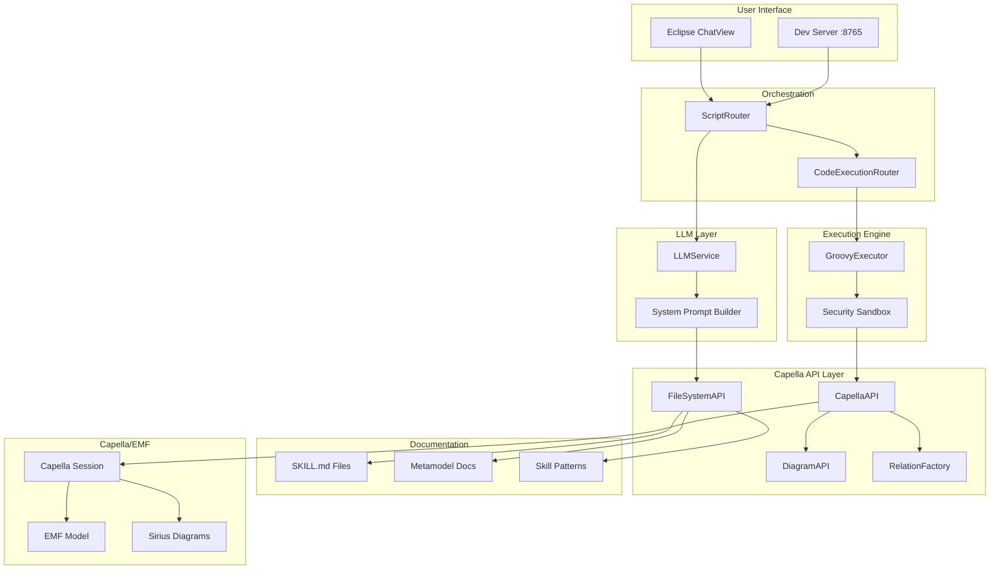

---

## Anthropic Pattern Implementation

### Pattern 1: Filesystem-Based Discovery

Instead of loading all API documentation into the system prompt (expensive), we teach the LLM to discover capabilities on-demand.

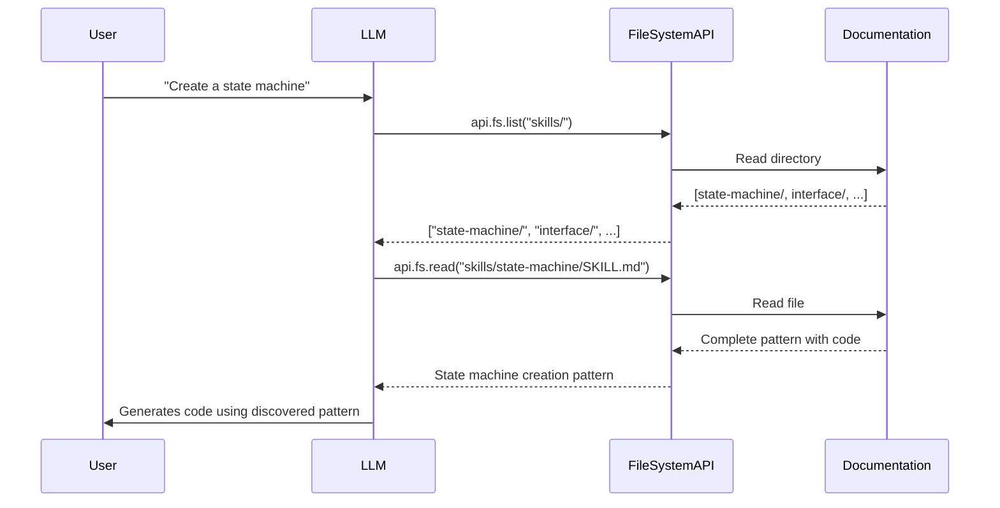

**Implementation:**

```
resources/capella-api/
├── SKILL.md                    # Root: How to use this API
├── api/
│   ├── SKILL.md               # API method overview
│   ├── find.md                # Finding elements
│   ├── create.md              # Creating elements
│   ├── link.md                # Creating relationships
│   ├── modify.md              # Modifying properties
│   └── diagram.md             # Diagram operations
├── metamodel/
│   ├── SKILL.md               # Metamodel overview
│   ├── oa/                    # Operational Analysis types
│   ├── sa/                    # System Analysis types
│   ├── la/                    # Logical Architecture types
│   └── pa/                    # Physical Architecture types
└── skills/                    # Reusable patterns
    ├── state-machine/
    │   └── SKILL.md           # Complete state machine pattern
    ├── interface/
    │   └── SKILL.md           # Interface definition pattern
    ├── diagram/
    │   └── SKILL.md           # Diagram creation + population patterns
    ├── requirements/
    │   └── SKILL.md           # Requirements viewpoint pattern
    └── arcadia-workflow/
        └── SKILL.md           # Full OA→SA→LA→PA workflow
```

**FileSystemAPI Methods:**

| Method | Purpose |
|--------|---------|
| `api.fs.list(path)` | List directory contents |
| `api.fs.read(path)` | Read documentation file |
| `api.fs.search(keyword)` | Full-text search across docs |
| `api.fs.saveSkill(name, code)` | Save reusable pattern |
| `api.fs.loadSkill(name)` | Load saved pattern |

### Pattern 2: Minimal System Prompt

Traditional prompts include full API documentation (~3000+ tokens). We use a minimal prompt (~300 tokens) that teaches discovery:

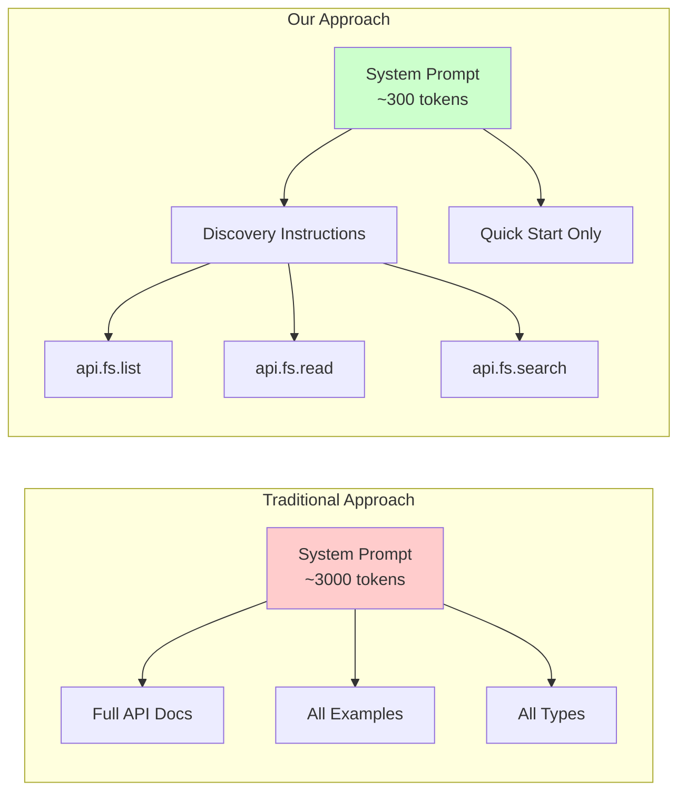

**System Prompt Structure:**

```java
// From CodeExecutionRouter.buildCodeExecutionPrompt()

## Code Execution

You can execute Groovy code to manipulate Capella models.

### Available Bindings
- `api` - Capella API (find, create, link, diagram, etc.)
- `api.fs` - Documentation discovery (list, read, search)
- `api.diagram` - Diagram operations
- `log` - Logger (log.info, log.warn, log.error)

### Discovering Capabilities
Use `api.fs.*` to explore available APIs on-demand:
// Example:
api.fs.list("")            // Root directories
api.fs.read("SKILL.md")    // Root documentation
api.fs.search("component") // Find relevant docs

### Quick Start
[Minimal examples for common operations]
 
### Recipes (Load On Demand)
[Read `skills/**/SKILL.md` for worked examples]
```

### Pattern 3: Worked Examples as Skills

For complex patterns (diagrams, requirements, interfaces, state machines), we store worked examples in skill files and load them on-demand via `api.fs.read(...)`.

```java
// From CodeExecutionRouter.buildCodeExecutionPrompt()
//
// Prompt stays short and points to skill docs, e.g.:
// - api.fs.read("skills/diagram/SKILL.md")
// - api.fs.read("skills/requirements/SKILL.md")
```

### Pattern 4: Error Feedback Loop

When code execution fails, we feed the error back to the LLM for self-correction:

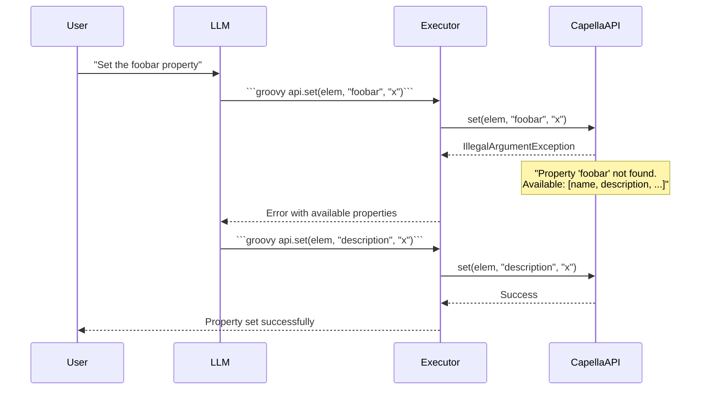

**Implementation:**

```java
// CodeExecutionRouter.executeWithRetry()
public static Result executeWithRetry(
    Session session,
    String llmResponse,
    int maxRetries,
    BiFunction<String, String, String> llmCallback
) {
    Result result = execute(session, llmResponse);

    int attempts = 0;
    while (!result.success && attempts < maxRetries) {
        // Format error for LLM understanding
        String errorFeedback = result.executionResult.formatForLLM();
        
        // Ask LLM to fix the code
        String correctedResponse = llmCallback.apply(llmResponse, errorFeedback);
        
        // Retry with corrected code
        result = execute(session, correctedResponse);
        attempts++;
    }
    return result;
}
```

### Pattern 5: Descriptive Exceptions

Silent failures (returning null/false) are replaced with descriptive exceptions:

```java
// Before (silent failure)
public boolean set(EObject element, String property, Object value) {
    if (feature == null) return false;  // LLM has no idea why
}

// After (descriptive exception)
public boolean set(EObject element, String property, Object value) {
    if (feature == null) {
        throw new IllegalArgumentException(
            "Property '" + property + "' not found on " + element.eClass().getName() +
            ". Available properties: " + availableProperties
        );
    }
}
```

---

## Component Deep Dive

### GroovyExecutor

Sandboxed execution environment for LLM-generated scripts.

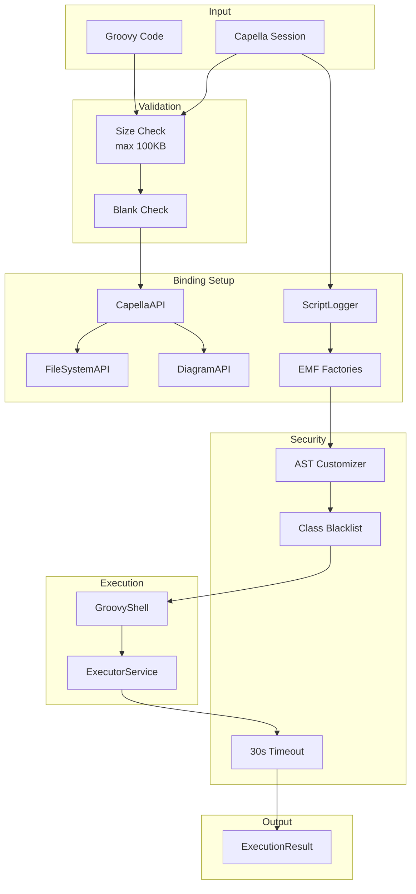

**Security Features:**

| Feature | Implementation |
|---------|----------------|
| Timeout | 30-second limit via ExecutorService |
| Class Blacklist | System, Runtime, File, Socket, ClassLoader, ProcessBuilder |
| AST Restrictions | No package definitions, restricted receivers |
| Size Limit | 100KB max script size |
| Memory Bounds | Cached thread pool limits concurrent execution |

**Script Bindings:**

```groovy
// Available in every script
api          // CapellaAPI instance
api.fs       // FileSystemAPI for documentation
api.diagram  // DiagramAPI for diagram operations
log          // ScriptLogger (log.info, log.warn, log.error)
session      // Raw Capella Session (advanced use)

// EMF Factories (for api.tx {} blocks)
OaFactory, CtxFactory, LaFactory, PaFactory
FaFactory, CsFactory, CapellacoreFactory
```

### CapellaAPI

Clean facade providing all model operations:

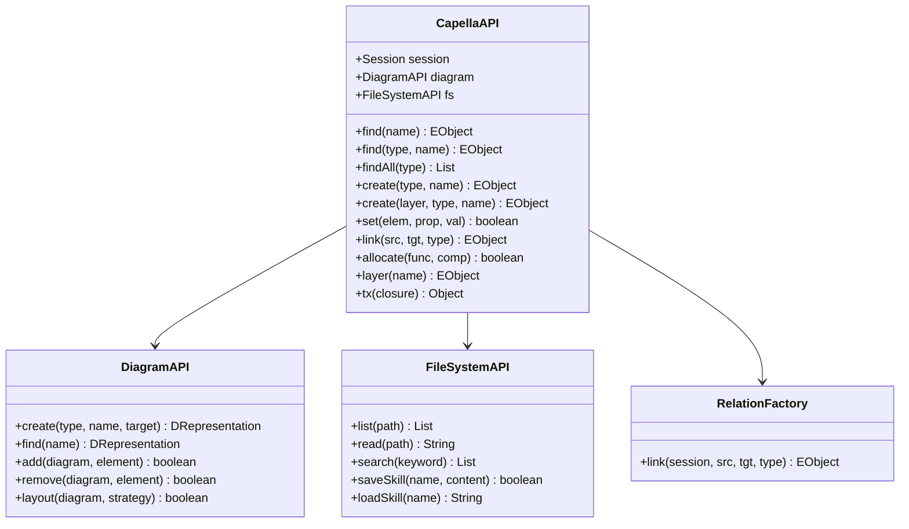

**Operation Categories:**

| Category | Methods | Description |
|----------|---------|-------------|
| **Find** | `find()`, `findAll()`, `query()`, `findById()` | Locate elements |
| **Create** | `create()` (3 overloads) | Create new elements |
| **Modify** | `set()`, `rename()`, `delete()` | Modify existing elements |
| **Link** | `link()`, `allocate()` | Create relationships |
| **Navigate** | `parent()`, `children()`, `descendants()` | Model traversal |
| **Diagram** | `diagram.create()`, `diagram.add()` | Diagram operations |
| **Raw** | `tx()` | Direct EMF/Factory access |

### ScriptRouter

Main orchestration layer connecting all components:

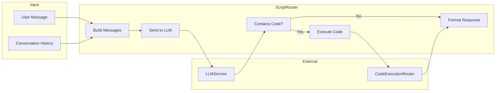

---

## Request/Response Flow

### Complete End-to-End Flow

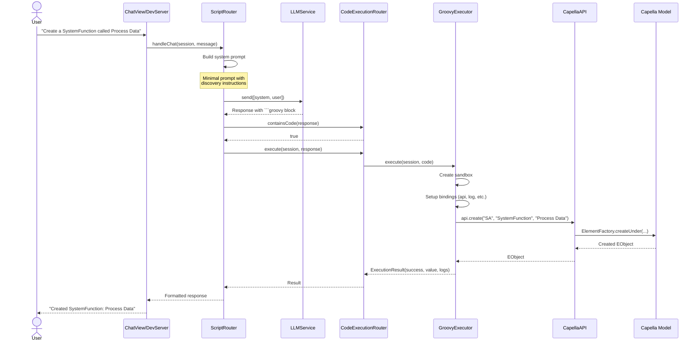

### Dev Server HTTP API

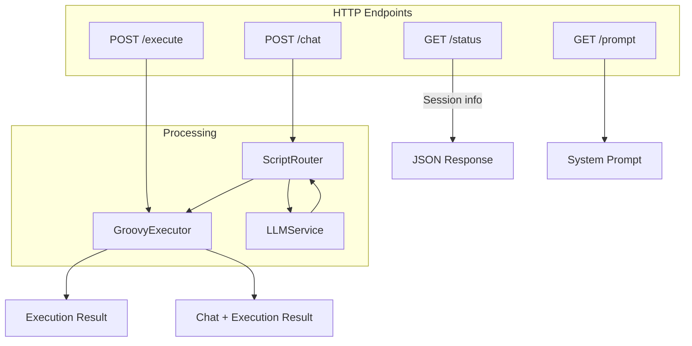

**Endpoints:**

| Endpoint | Method | Purpose |
|----------|--------|---------|
| `/status` | GET | Check server and session status |
| `/execute` | POST | Execute Groovy code directly |
| `/chat` | POST | Full LLM chat with code execution |
| `/prompt` | GET | Get current system prompt |

---

## Security Model

### Defense in Depth

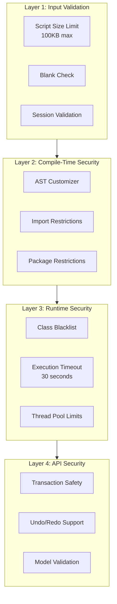

### Blacklisted Classes

```java
private static final Set<String> BLACKLIST = Set.of(
    "java.lang.System",
    "java.lang.Runtime",
    "java.lang.ProcessBuilder",
    "java.io.File",
    "java.io.FileInputStream",
    "java.io.FileOutputStream",
    "java.net.Socket",
    "java.net.ServerSocket",
    "java.lang.reflect.Method",
    "java.lang.ClassLoader"
);
```

### Transaction Safety

All model mutations are wrapped in EMF transactions via `SessionSafeguards`:

```java
SessionSafeguards.runWrite(session, "Create element", () -> {
    // All mutations here are:
    // - Executed on UI thread
    // - Wrapped in write transaction
    // - Support undo/redo
    // - Rolled back on error
    return element;
});
```

---

## Token Economics

### Comparison: Traditional vs Discovery Pattern

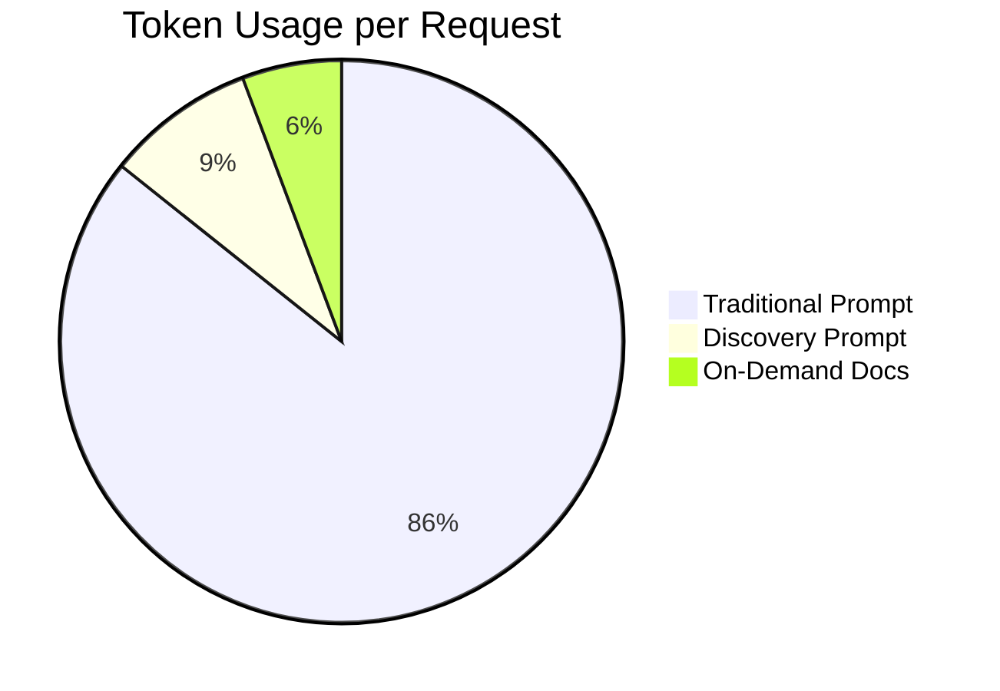

| Approach | System Prompt | Per-Request Overhead | Total |
|----------|---------------|---------------------|-------|
| Traditional | ~3000 tokens | 0 | 3000 |
| Discovery | ~300 tokens | ~200 (when docs needed) | 500 |
| **Savings** | | | **83%** |

### When Documentation is Loaded

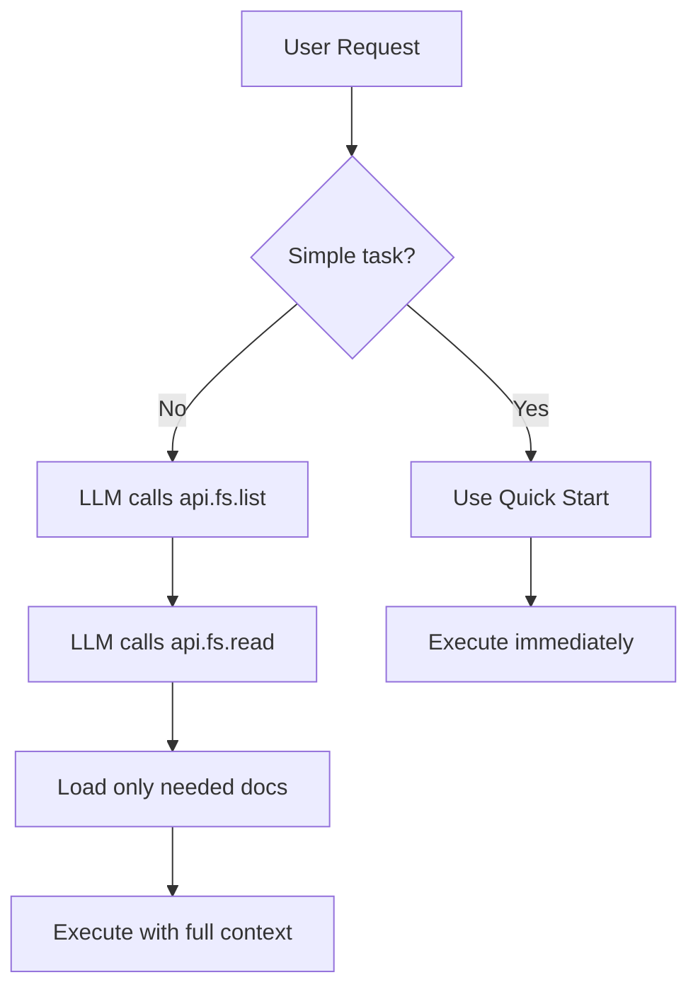

**Key insight**: Most requests don't need full documentation. The LLM learns common patterns and only loads docs for unfamiliar tasks.

---

## File Reference

### Core Components

| File | Purpose |
|------|---------|
| `scripting/CodeExecutionRouter.java` | Routes LLM responses to executor |
| `scripting/GroovyExecutor.java` | Sandboxed Groovy execution |
| `scripting/CapellaAPI.java` | Main model API facade |
| `scripting/DiagramAPI.java` | Diagram operations |
| `scripting/FileSystemAPI.java` | Documentation discovery |
| `scripting/RelationFactory.java` | Relationship creation |
| `scripting/ScriptRouter.java` | Chat orchestration |
| `scripting/ExecutionResult.java` | Execution result type |
| `scripting/ScriptLogger.java` | Log capture |

### Documentation Structure

| Path | Purpose |
|------|---------|
| `resources/capella-api/SKILL.md` | Root documentation |
| `resources/capella-api/api/` | API method docs |
| `resources/capella-api/metamodel/` | Capella types by layer |
| `resources/capella-api/skills/` | Reusable patterns |

### Supporting Infrastructure

| File | Purpose |
|------|---------|
| `llm/LLMService.java` | OpenAI/Anthropic client |
| `dev/DevServer.java` | HTTP REST API |
| `model/ModelSummary.java` | Context generation |
| `session/SessionSafeguards.java` | Transaction safety |

---

## Summary

Capella AI implements Anthropic's code execution patterns to provide:

1. **Full Capability**: LLM has access to entire Capella/EMF API via Groovy
2. **Token Efficiency**: 83%+ reduction through filesystem-based discovery
3. **Self-Correction**: Error feedback loop enables automatic retry
4. **Security**: Multi-layer sandbox with timeout, blacklists, and transactions
5. **Composability**: Complex operations in single scripts without round-trips

The architecture prioritizes giving the LLM maximum capability while maintaining security and efficiency through the patterns proven by Anthropic's research.
