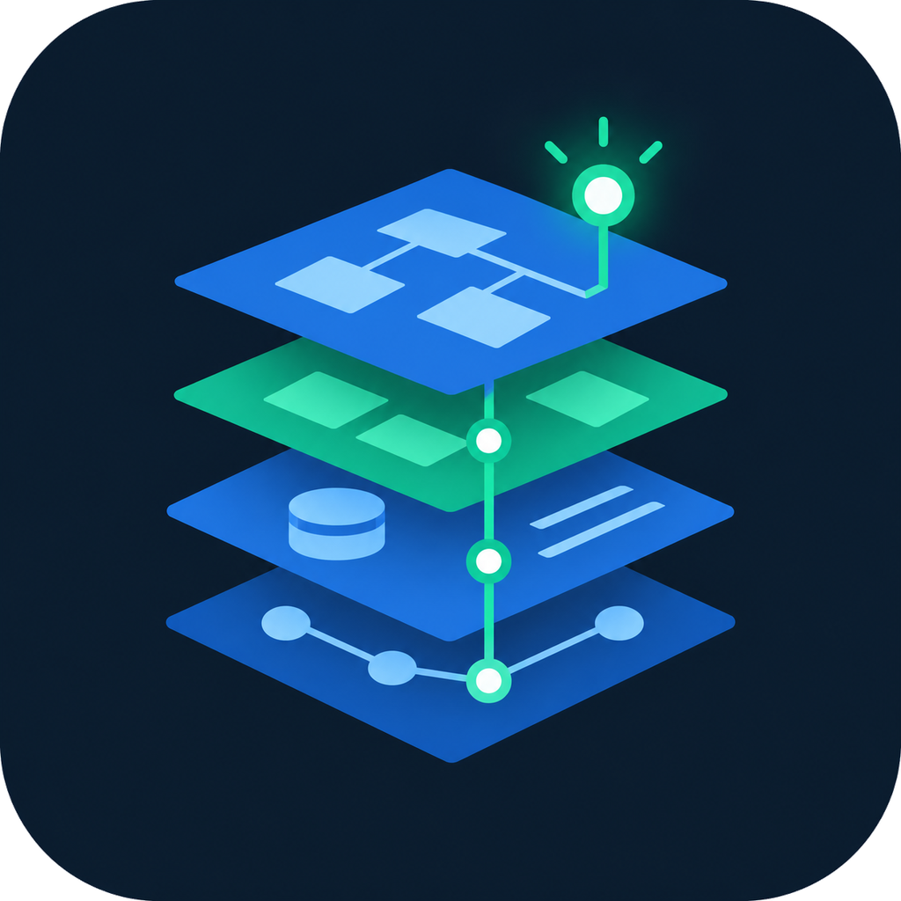
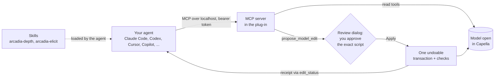

<div align="center">



# Agent Toolkit for Eclipse Capella®

**AI assistance for model-based systems engineering in [Capella](https://eclipse.dev/capella/): ask questions about
your Arcadia model, and have changes proposed that you review before anything runs.**

[](https://github.com/sidkolapalli/agent-toolkit-for-capella/actions/workflows/build.yml)
[](LICENSE)
[](https://eclipse.dev/capella/)
[](https://modelcontextprotocol.io)
[](https://agentskills.io)

[Install](docs/INSTALL.md) · [What you can do](#what-you-can-do) · [Quick start](#quick-start) ·
[Example model](https://github.com/sidkolapalli/fsae-2027-model-for-capella)

</div>

An Eclipse plug-in for Capella 7 connects an AI agent of your choice (Claude Code, Codex, Cursor, GitHub Copilot,
Gemini CLI and others) to the model open in Capella. The agent reads the model through typed tools and proposes
every change as a script that you approve in Capella. Agent skills add what general-purpose agents lack about the
Arcadia method.

## What you can do

- **Understand a model.** Get a summary of each perspective, find elements, follow traceability from a requirement
  to the functions and components that satisfy it, and have validation warnings explained.
- **Model with the method.** Create and connect operational activities, system functions, logical and physical
  components, exchanges, interfaces, functional chains, scenarios, modes and states, and the realizations between
  perspectives, from OA down to EPBS, and lay out diagrams.
- **Get the Arcadia constructs right.** The [`arcadia-depth`](skills/arcadia-depth/SKILL.md) skill teaches the
  constructs agents tend to get wrong, such as modes versus states, exchange items, interfaces, capability
  relations, control functions and physical paths, each with its method rule and the matching page of Capella's
  help.
- **Start a new system by interview.** The [`arcadia-elicit`](skills/arcadia-elicit/SKILL.md) skill has the agent
  ask about purpose, users and design decisions, in Arcadia order, before it models anything.
- **Stay in control.** Nothing changes until you approve the exact script in Capella. An approved change runs once,
  in one undoable transaction, and you get a receipt: what changed, the declared checks, and the validator's
  findings before and after.

Capella also gets a built-in chat assistant, **AI Assistant for Capella**, for working without an external agent; see
[docs/PLUGIN.md](docs/PLUGIN.md).

### Example requests

- "Summarize the logical architecture: the subsystems and what they exchange."
- "Which functions and components satisfy requirement EV.8.2, and is anything left untraced?"
- "Explain the validation warnings on the physical architecture and propose fixes."
- "Add a Charging mode to the vehicle and the transitions into it from Ready and Off."
- "Create a functional chain from the driver's pedal input to motor torque, through the driver-demand functions."
- "Realize the logical component Sensor with a physical component, preserving traceability."
- "Interview me about a battery management system before you model it."

## How it works



## Quick start

You need Capella 7.0, a Java 17 JDK, Maven 3.9.11 (the version the build is tested with) and Python 3.

**1. Build the plug-in.**

```bash
python scripts/fetch-codex.py   # the Codex runtime bundled for the in-Capella chat (Windows x64), checked against provenance.json
export JAVA_TOOL_OPTIONS='-Djdk.xml.maxGeneralEntitySizeLimit=0 -Djdk.xml.totalEntitySizeLimit=0 -Djdk.xml.entityExpansionLimit=0'
mvn -f plugins clean verify
```

On Windows PowerShell, set the variable with `$env:JAVA_TOOL_OPTIONS='...'`. The update site is written to
`plugins/ai-capella-repository/target/repository`.

**2. Install it.** In Capella, choose **Help → Install New Software → Add → Local**, select that folder, install
**AI Assistant for Capella** and restart.

**3. Start the MCP server.** Open a model, then **Window → Show View → Other → AI Dev Server → Start** (port 8765).

**4. Connect your agent and add the skills.** Set a fixed token first, so your agent's configuration survives
Capella restarts: set `CAPELLA_AI_DEVSERVER_TOKEN` to a random value for both Capella and your agent
([how](docs/INSTALL.md#set-a-fixed-mcp-token)). Then pick your agent:

| Agent | Fastest route |
|---|---|
| Claude Code | `/plugin marketplace add sidkolapalli/agent-toolkit-for-capella`, then `/plugin install agent-toolkit-for-capella@sidkolapalli` (skills and server in one step) |
| Any agent with Agent Skills | `npx skills add sidkolapalli/agent-toolkit-for-capella` or `gh skill install sidkolapalli/agent-toolkit-for-capella --all`, then connect the server |
| Codex, Cursor, GitHub Copilot, Gemini CLI, Windsurf / Devin, OpenCode, Claude Desktop | Step-by-step in [docs/INSTALL.md](docs/INSTALL.md), from each tool's official documentation |

Then run `/capella-setup` (Codex: `$capella-setup`) to check the connection, and ask for the work in plain
language. Each change opens a review dialog in Capella.

To try it on a full model first, use
[fsae-2027-model-for-capella](https://github.com/sidkolapalli/fsae-2027-model-for-capella): a Capella model of a
Formula SAE 2027 electric car, with the rules as requirements, a candidate architecture across all five perspectives,
and open design decisions.

## Safety and privacy

- The server listens on your machine only, refuses browser requests, and requires a bearer token that it writes to
  `~/.capella-ai/devserver-<port>.token` and deletes on stop.
- Read tools never change the model. Changes run only after you approve them, once, in one undoable transaction.
- Model content returned to the agent is data, not instructions.
- The toolkit sends nothing anywhere. The plug-in's telemetry and dataset logging are off unless you turn them on,
  and stay local when on. What your agent reads from the model goes to that agent's model provider under that
  provider's terms, as with any file the agent reads.

## Skills

- [`capella-setup`](skills/capella-setup/SKILL.md): start the server and register it with your agent.
- [`arcadia-depth`](skills/arcadia-depth/SKILL.md): the parts of Arcadia an agent tends to get wrong (modes and
  states, exchange items, interfaces, missions, capability relations, operational roles, control functions,
  property values, categories, scenarios, chains, physical paths, transitions), each with its method rule, a
  verified API pattern and the matching page of Capella's help.
- [`arcadia-elicit`](skills/arcadia-elicit/SKILL.md): interview the user (experience, purpose, then the design
  decisions in Arcadia order) before modelling a new system.

Setup runs only when you call it. The other skills load when a task needs them, and the MCP server's instructions
point the agent to `arcadia-depth` before modelling.

## Platforms

Built and tested on Windows with Capella 7.0.0. The build and all tests also pass on Linux (Ubuntu under WSL2), and
Capella 7.0.0 for Linux ran the chat review, diagram and MCP edit flows. macOS has not been run. The bundled Codex
runtime is Windows x64 only; elsewhere the chat needs an external Codex 0.160.1 or a direct API provider (see
[docs/PLUGIN.md](docs/PLUGIN.md)). The MCP server needs neither.

## Contributing

[`CONTRIBUTING.md`](CONTRIBUTING.md) covers building, testing and the branch workflow, and
[`ARCHITECTURE.md`](ARCHITECTURE.md) explains how the code fits together. The plug-in is in [`plugins/`](plugins),
the skills in [`skills/`](skills), and the evaluation harness in
[`test-models/evals`](test-models/evals).

## Trademarks

Eclipse, Eclipse Capella and Capella are trademarks of Eclipse Foundation AISBL. This project is not affiliated with
or endorsed by the Eclipse Foundation.

## License

[Eclipse Public License 2.0](LICENSE), as for Capella itself. The vendored `writing-for-agents` skill keeps its MIT
license, and the Codex runtime fetched by `scripts/fetch-codex.py` is Apache-2.0 (see its `LICENSE` and `NOTICE`).
